<div align="center" width="100%">

<a href="https://github.com/gravitton">
<picture>
  <source media="(prefers-color-scheme: dark)" srcset="https://raw.githubusercontent.com/gravitton/grid/refs/heads/main/docs/images/logo-dark.svg">
  <source media="(prefers-color-scheme: light)" srcset="https://raw.githubusercontent.com/gravitton/grid/refs/heads/main/docs/images/logo-light.svg">
  
</picture>
</a>

[![Latest Stable Version][ico-release]][link-release]
[![Build Status][ico-workflow]][link-workflow]
[![Coverage Status][ico-coverage]][link-coverage]
[![Go Dev Reference][ico-go-dev-reference]][link-go-dev-reference]
[![Go Version][ico-go-version]][link-go]
[![Software License][ico-license]][link-licence]

Generic 2D grid library for game development

<hr>

</div>

<p align="center">
<picture>
  <source media="(prefers-color-scheme: dark)" srcset="https://raw.githubusercontent.com/gravitton/grid/refs/heads/main/docs/images/hero-dark.svg">
  <source media="(prefers-color-scheme: light)" srcset="https://raw.githubusercontent.com/gravitton/grid/refs/heads/main/docs/images/hero-light.svg">
  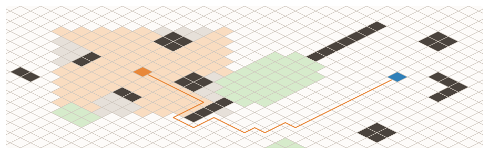
</picture>
</p>

One API on every layout: the same calls on one map, answered by each grid's own neighbors.

<p align="center">
<picture>
  <source media="(prefers-color-scheme: dark)" srcset="https://raw.githubusercontent.com/gravitton/grid/refs/heads/main/docs/images/explorations-dark.svg">
  <source media="(prefers-color-scheme: light)" srcset="https://raw.githubusercontent.com/gravitton/grid/refs/heads/main/docs/images/explorations-light.svg">
  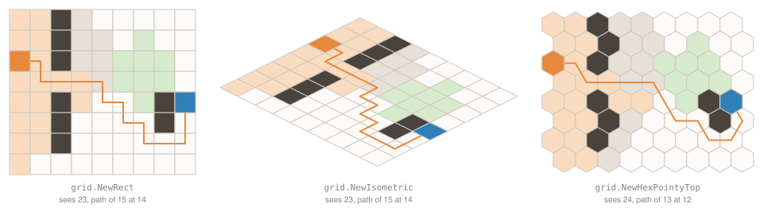
</picture>
</p>

Every picture in this README is drawn from the package's own results: the cells coloured are the
ones the code beside them returns.

## Features

- **Generic** – `Grid[T]` holds a value of any type per cell, in one flat array.
- **Four layouts** – rectangular, isometric, hexagonal flat-top and pointy-top, behind one API.
- **World space** – the cell under a point, and the center, bounds and polygon of every cell.
- **Neighbors** – four or eight on a square grid, six on a hexagonal one, with range, ring, spiral and line.
- **Visibility** – line of sight and field of view on every layout, the same from either end.
- **Pathfinding** – A*, Dijkstra, greedy best-first and breadth-first, with fields for movement ranges and flow.
- **Regions** – immutable sets of cells with set operations, borders, growth and components.
- **Draw order** – the cells in view, back to front, whatever the layout.
- **Hex layout** – the world space of hexes kept outside a grid, over `gravitton/hexagon`.
- **Extras** – `Square` lattice queries, JSON, and `Seq` forms that allocate nothing.

The rules behind them are in the [package documentation][link-go-dev-reference].

## Installation

```shell
go get github.com/gravitton/grid
```

```go
import (
	geom "github.com/gravitton/geometry"
	"github.com/gravitton/grid"
)
```

## Usage

A grid stores a value per cell, and every question it answers takes a callback reading that value.
The figures below use one tile type:

```go
type Tile struct {
	Wall bool    // blocks the way and the view
	Cost float64 // what a step onto the tile costs
}

walkable := func(cell grid.Cell[Tile]) bool {
	return !cell.Value().Wall
}

opaque := func(cell grid.Cell[Tile]) bool {
	return cell.Value().Wall
}

cost := func(current, next grid.Cell[Tile]) float64 {
	return next.Value().Cost
}
```

The map at the top, call by call:

```go
g := grid.NewIsometric[Tile](geom.Sz(40, 40), grid.IsometricPixelCellScale(40))
g.Fill(Tile{Cost: 1})
g.Cell(geom.Pt(21, 8)).Set(Tile{Wall: true}) // and the other walls; rough ground is Tile{Cost: 5}

scout, goal := geom.Pt(14, 24), geom.Pt(27, 12)
g.FieldOfView(scout, 8, opaque)     // the 116 cells the scout sees, the walls in front included
g.Path(scout, goal, walkable, cost) // 32 cells around the wall and the rough ground, at a cost of 31

view := geom.BoxFromMin(g.Bounds().Center().Add(geom.Vec(-468.0, -110.0)), geom.Sz(936.0, 280.0))
for cell := range g.DrawOrder(view) { // the cells in the window shown, back to front
	// draw cell.Polygon()
}
```

The three maps below it, painted into a `NewRect`, a `NewIsometric` and a `NewHexPointyTop` grid,
run one function:

```go
scout, goal := geom.Pt(0, 2), geom.Pt(8, 4)

explore := func(g *grid.Grid[Tile]) {
	g.FieldOfView(scout, 5, opaque)     // 23 cells on a square grid, 24 on a hexagonal one
	g.Path(scout, goal, walkable, cost) // a cost of 14 on a square grid, 12 on a hexagonal one
}
```

In every figure a wall is a solid cell, and rough ground, costing five, is green.

### Grids

Four constructors, one for each layout, return the same `*Grid[T]`, so everything below holds on
all of them. An index is a `grid.Index`, the `geom.Point[int]` of a column and a row, on every
layout. The origin, the dot, is the top-left corner of the bounds, the dashed box.

<p align="center">
<picture>
  <source media="(prefers-color-scheme: dark)" srcset="https://raw.githubusercontent.com/gravitton/grid/refs/heads/main/docs/images/grids-dark.svg">
  <source media="(prefers-color-scheme: light)" srcset="https://raw.githubusercontent.com/gravitton/grid/refs/heads/main/docs/images/grids-light.svg">
  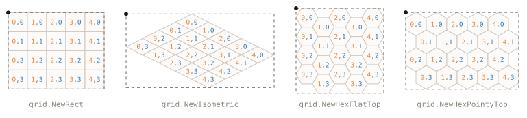
</picture>
</p>

```go
size := geom.Sz(5, 4)

grid.NewRect[Tile](size, grid.RectCellScale(28))                 // squares
grid.NewIsometric[Tile](size, grid.IsometricPixelCellScale(48))  // 2:1 diamonds, (0,0) at the top
grid.NewHexFlatTop[Tile](size, grid.HexFlatTopCellScale(32))     // odd columns shifted down
grid.NewHexPointyTop[Tile](size, grid.HexPointyTopCellScale(30)) // odd rows shifted right
```

Options are set in a callback, on [`SquareOptions`][link-go-dev-reference] for the square grids and
`HexOptions` for the hexagonal ones:

```go
grid.NewRect[Tile](size, grid.RectCellScale(28), func(options *grid.SquareOptions) {
	options.Movement = grid.MovementDiagonal // 8 neighbors
	options.Origin = geom.Pt(100.0, 50.0)    // the top-left corner of the grid in the world
})

grid.NewHexFlatTop[Tile](size, grid.HexFlatTopCellScale(32), func(options *grid.HexOptions) {
	options.EvenOffset = true // even columns shifted instead
})
```

A constructor takes the cell scale: the size of a square or a diamond, the circumradius per axis
of a hexagon. The helpers give it from the width a tile is drawn at:

| Helper                       | Tile, `w` wide                 |
|------------------------------|--------------------------------|
| `RectCellScale`              | Square, `w` tall               |
| `IsometricCellScale`         | Diamond at 30°, `w·0.577` tall |
| `IsometricPixelCellScale`    | Diamond, `w/2` tall            |
| `HexFlatTopCellScale`        | Regular hex, `w·√3/2` tall     |
| `HexPointyTopCellScale`      | Regular hex, `w·2/√3` tall     |
| `HexFlatTopPixelCellScale`   | Squashed hex, `w·3/4` tall     |
| `HexPointyTopPixelCellScale` | Squashed hex, `w` tall         |

### Cells

A `Cell` is a handle on one index of a grid, two words passed by value. What belongs to one cell
is asked of the cell; what relates cells, of the grid.

```go
g := grid.NewRect[Tile](geom.Sz(7, 7), grid.RectCellScale(20))
g.Fill(Tile{Cost: 1})

cell := g.Cell(geom.Pt(3, 4)) // Cell(3,4)
cell.Value().Cost = 5         // a pointer into the grid, nil outside it
cell.Set(Tile{Wall: true})    // a write outside the grid does nothing
cell.IsContained()            // true; also g.Contains(index)
g.Size()                      // 7x7; also Width and Height

for cell := range g.All() { // every cell, row by row
	cell.Value().Cost = 1
}

g.Select(walkable) // a Region of the cells a callback picks
g.Clone()          // a copy with storage of its own; also Fill and Clear
g.Layer[bool]()    // a grid of another type over the same cells, an index of one an index of the other
```

Outside the grid nothing panics: a read gives the zero answer, a write does nothing, and a query
from an index outside is empty.

### World space

`IndexAt` gives the cell under a point, for the cursor or a unit moving freely. Every dot below
is coloured by the cell it gives: a point on an edge goes to the same side in every cell, so the
cells tile the bounds with no gap and no overlap.

<p align="center">
<picture>
  <source media="(prefers-color-scheme: dark)" srcset="https://raw.githubusercontent.com/gravitton/grid/refs/heads/main/docs/images/world-dark.svg">
  <source media="(prefers-color-scheme: light)" srcset="https://raw.githubusercontent.com/gravitton/grid/refs/heads/main/docs/images/world-light.svg">
  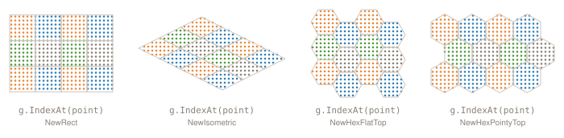
</picture>
</p>

```go
g := grid.NewRect[Tile](geom.Sz(4, 3), grid.RectCellScale(32))

g.IndexAt(geom.Pt(50.0, 40.0)) // (1,1), the cell under a point; CellAt gives it as a cell

cell := g.Cell(geom.Pt(1, 1))
cell.Center()  // (48,48)
cell.Bounds()  // (32,32)-(64,64), the geom.Box around the tile
cell.Polygon() // the square, diamond or hexagon to draw or hit-test

g.Bounds()      // (0,0)-(128,96)
g.CellSize()    // 32x32, one tile as drawn
g.CellSpacing() // the step between two tiles, smaller than the tile where they interlock
g.CellScale()   // what the constructor took; also Origin

g.MoveTo(geom.Pt(100.0, 50.0))    // the top-left corner of the bounds, to scroll the grid
g.Rescale(grid.RectCellScale(48)) // the scale of a tile, to zoom it
```

### Drawing

`DrawOrder` yields the cells in view back to front, in the order the layout needs, so a tile is
never drawn over one in front of it.

<p align="center">
<picture>
  <source media="(prefers-color-scheme: dark)" srcset="https://raw.githubusercontent.com/gravitton/grid/refs/heads/main/docs/images/draw-order-dark.svg">
  <source media="(prefers-color-scheme: light)" srcset="https://raw.githubusercontent.com/gravitton/grid/refs/heads/main/docs/images/draw-order-light.svg">
  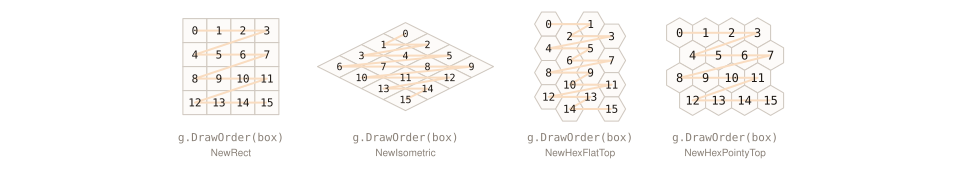
</picture>
</p>

```go
for cell := range g.DrawOrder(viewport) { // a zero box walks the whole grid
	draw(cell.Polygon(), cell.Value())
}
```

| Layout         | Order                                      |
|----------------|--------------------------------------------|
| Rectangular    | Row by row, top to bottom                  |
| Isometric      | By depth, `column + row` ascending         |
| Hex flat-top   | Row by row, the columns drawn higher first |
| Hex pointy-top | Row by row                                 |

A tile partly in view is included; a cell outside the grid never is.

### Neighbors and distance

A square grid moves in four directions or eight, as its `Movement` says, and a hexagonal one in
six. Neighbors come by increasing angle, clockwise on a screen from the right, and a neighbor is
exactly a cell at distance one.

<p align="center">
<picture>
  <source media="(prefers-color-scheme: dark)" srcset="https://raw.githubusercontent.com/gravitton/grid/refs/heads/main/docs/images/movement-dark.svg">
  <source media="(prefers-color-scheme: light)" srcset="https://raw.githubusercontent.com/gravitton/grid/refs/heads/main/docs/images/movement-light.svg">
  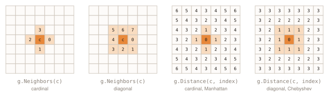
</picture>
</p>

```go
c := geom.Pt(3, 3)

g.Neighbors(c)               // [(4,3) (3,4) (2,3) (3,2)], inside the grid; also NeighborsSeq
g.Distance(c, geom.Pt(5, 1)) // 4, Manhattan; 2 with MovementDiagonal, Chebyshev
cell.Neighbors()             // the same, from a cell; also DistanceTo
```

`Distance` alone measures between any two indices, inside the grid or not.

### Movement

`Movement` names those two ways, over the directions of [`gravitton/geometry`][link-geometry]:

```go
grid.MovementCardinal.Directions()                           // Right, Down, Left, Up
grid.MovementDiagonal.Offsets()                              // the 8 steps as vectors, by increasing angle
grid.MovementCardinal.Offset(geom.DirectionUp)               // ⟨0,-1⟩, the zero vector for a direction it lacks
grid.MovementCardinal.Contains(geom.DirectionUpRight)        // false
grid.MovementDiagonal.Distance(geom.Pt(0, 0), geom.Pt(3, 5)) // 5, Chebyshev; MovementCardinal gives 8

grid.Movements()                    // both, as a fresh array
grid.ParseMovement("Diagonal")      // the name back to the constant, "None" to MovementNone
json.Marshal(grid.MovementCardinal) // "Cardinal"
```

### Range, ring, spiral and line

`Range` is exactly the cells within a radius by `Distance`, so its shape follows the movement:
a diamond, a square, a hexagon.

<p align="center">
<picture>
  <source media="(prefers-color-scheme: dark)" srcset="https://raw.githubusercontent.com/gravitton/grid/refs/heads/main/docs/images/range-dark.svg">
  <source media="(prefers-color-scheme: light)" srcset="https://raw.githubusercontent.com/gravitton/grid/refs/heads/main/docs/images/range-light.svg">
  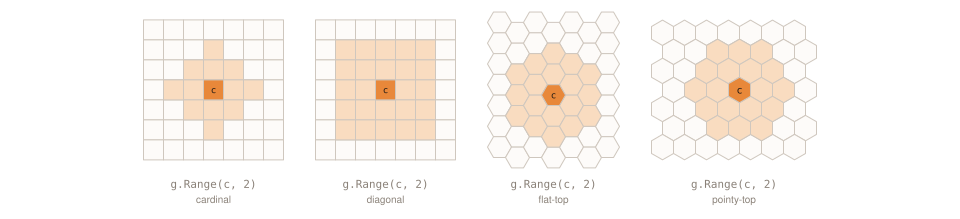
</picture>
</p>

```go
g.Range(c, 2) // a Region of the 13 cells within two steps; 25 with MovementDiagonal, 19 on a hexagonal grid
cell.Range(2) // the same, from a cell
```

A ring, a spiral and a line walk the grid in its own indices, on every layout. On a grid with
`MovementDiagonal`:

<p align="center">
<picture>
  <source media="(prefers-color-scheme: dark)" srcset="https://raw.githubusercontent.com/gravitton/grid/refs/heads/main/docs/images/traversal-dark.svg">
  <source media="(prefers-color-scheme: light)" srcset="https://raw.githubusercontent.com/gravitton/grid/refs/heads/main/docs/images/traversal-light.svg">
  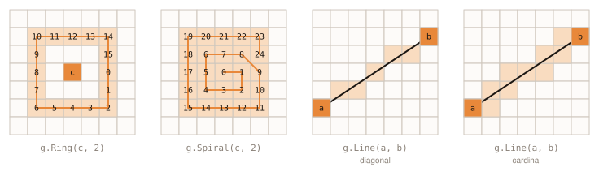
</picture>
</p>

```go
g.Ring(c, 2)   // the 16 cells exactly two steps away, by increasing angle from the right
g.Spiral(c, 2) // the 25 cells of Range, nearest first, ring by ring

a, b := geom.Pt(0, 5), geom.Pt(6, 1)
g.Line(a, b) // the 7 cells from a to b, each a neighbor of the last; 11 with MovementCardinal
```

A ring and a spiral keep the cells inside the grid; a line is measured between any two indices, as
`Distance` is. Each has a `Seq` form, `RangeSeq`, `RingSeq`, `SpiralSeq` and `LineSeq`, that walks
the cells without a buffer and stops where you break:

```go
for index := range g.SpiralSeq(c, 5) { // nearest first, stops at the break
	if free(index) {
		break
	}
}
```

To reuse a buffer, collect a `Seq` form with the standard library's `slices.AppendSeq`.

### Line of sight

Sight runs between the centers of two cells. A wall it passes through blocks it; where it passes
exactly through a corner, it takes both cells beside the corner to block: a diagonal wall is
opaque, a single pillar is not.

<p align="center">
<picture>
  <source media="(prefers-color-scheme: dark)" srcset="https://raw.githubusercontent.com/gravitton/grid/refs/heads/main/docs/images/corners-dark.svg">
  <source media="(prefers-color-scheme: light)" srcset="https://raw.githubusercontent.com/gravitton/grid/refs/heads/main/docs/images/corners-light.svg">
  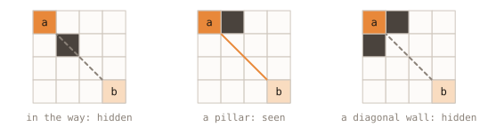
</picture>
</p>

```go
a, b := geom.Pt(0, 0), geom.Pt(3, 3)

g.HasLineOfSight(a, b, opaque) // false with a wall at (1,1), in the way
                               // true with a wall at (1,0) alone, a pillar
                               // false with walls at (1,0) and (0,1), a diagonal wall
```

The rule reads the same from either end, so two cells always see each other or neither does, and
neither end blocks. A hexagonal grid uses the rule of [`gravitton/hexagon`][link-hexagon].

### Field of view

`FieldOfView` is the cells within a radius that a cell sees: what a unit sees, or what a blast
reaches. A wall is in sight and hides what lies behind it, and what lies outside the grid blocks
nothing.

<p align="center">
<picture>
  <source media="(prefers-color-scheme: dark)" srcset="https://raw.githubusercontent.com/gravitton/grid/refs/heads/main/docs/images/sight-dark.svg">
  <source media="(prefers-color-scheme: light)" srcset="https://raw.githubusercontent.com/gravitton/grid/refs/heads/main/docs/images/sight-light.svg">
  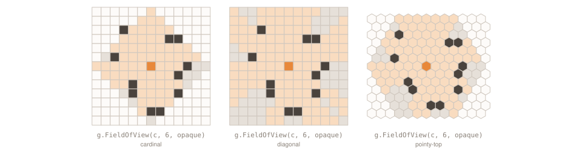
</picture>
</p>

```go
g.FieldOfView(c, 6, opaque) // the 76 of the 85 cells within six steps that c sees; also FieldOfViewSeq
cell.FieldOfView(6, opaque) // the same, from a cell
```

It asks `opaque` about each cell once and never about `c`. What blocks the view is apart from what
blocks the way, so each is its own callback: water is seen across, and a unit can stand where it
hides.

### Pathfinding

`Path` is the cheapest path where no step costs less than one, both ends included, or nil where
there is none.

<p align="center">
<picture>
  <source media="(prefers-color-scheme: dark)" srcset="https://raw.githubusercontent.com/gravitton/grid/refs/heads/main/docs/images/paths-dark.svg">
  <source media="(prefers-color-scheme: light)" srcset="https://raw.githubusercontent.com/gravitton/grid/refs/heads/main/docs/images/paths-light.svg">
  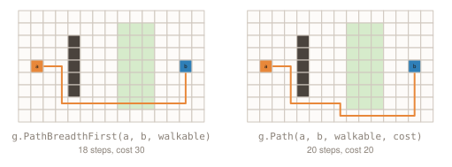
</picture>
</p>

```go
a, b := geom.Pt(1, 4), geom.Pt(13, 4)

g.PathBreadthFirst(a, b, walkable) // 19 cells, the fewest steps, through the rough ground: a cost of 30
g.Path(a, b, walkable, cost)       // 21 cells around it, the cheapest: a cost of 20
cell.PathTo(b, walkable, cost)     // the same, from a cell
```

A nil callback means no constraint: every cell is passable, every step costs one. A cost of +Inf
is a step never taken; a negative cost or a NaN panics.

`Path` is A*. To ask for a search by name:

| Method                                         | Algorithm         | Weighted | Shortest |
|------------------------------------------------|-------------------|----------|----------|
| `PathBreadthFirst(start, goal, passable)`      | Breadth-first     | no       | in steps |
| `PathUniformCost(start, goal, passable, cost)` | Dijkstra          | yes      | yes      |
| `PathGreedyBestFirst(start, goal, passable)`   | Greedy best-first | no       | no       |
| `PathAStar(start, goal, passable, cost)`       | A*                | yes      | at ≥ 1   |

### Fields

A `Field` is what a search reached: every cell, the step back toward its start and the cost of
getting there. `Reachable` is where a unit can move on a budget, with the way to each cell. A field
searched from a goal serves every unit heading there, each following `Next`, where a step costs
the same both ways.

<p align="center">
<picture>
  <source media="(prefers-color-scheme: dark)" srcset="https://raw.githubusercontent.com/gravitton/grid/refs/heads/main/docs/images/fields-dark.svg">
  <source media="(prefers-color-scheme: light)" srcset="https://raw.githubusercontent.com/gravitton/grid/refs/heads/main/docs/images/fields-light.svg">
  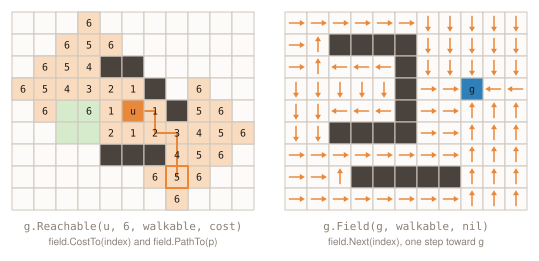
</picture>
</p>

```go
reach := g.Reachable(u, 6, walkable, cost) // the 35 cells u reaches for 6 or less

reach.CostTo(p) // 5, true: what it costs to get there
reach.PathTo(p) // [(5,4) (6,4) (6,5) (7,5) (7,6) (7,7)], from u to p; also AppendPathTo
reach.Next(p)   // (7,6), true: one step back toward u
reach.Region()  // the cells to highlight; also All, Len and Contains

flow := g.Field(goal, walkable, nil) // every cell with a way to the goal
flow.Next(geom.Pt(3, 3))             // (3,4), true: the step to take toward the goal
```

`Field` is breadth-first with a nil cost and Dijkstra with one; `FieldBreadthFirst` and
`FieldUniformCost` ask for them by name.

### Regions

`Region` is an immutable set of indices, held once each and sorted. Every query that returns a
set of cells returns one, and what depends on which cells are adjacent is asked of the grid:

<p align="center">
<picture>
  <source media="(prefers-color-scheme: dark)" srcset="https://raw.githubusercontent.com/gravitton/grid/refs/heads/main/docs/images/regions-dark.svg">
  <source media="(prefers-color-scheme: light)" srcset="https://raw.githubusercontent.com/gravitton/grid/refs/heads/main/docs/images/regions-light.svg">
  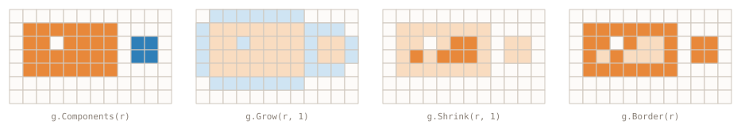
</picture>
</p>

```go
g.Components(r)  // its 2 pieces, as regions
g.IsConnected(r) // false
g.Grow(r, 1)     // the 60 cells of r and within one step of it
g.Shrink(r, 1)   // the 6 cells of r more than one step from its outside
g.Border(r)      // the 25 cells of r with a neighbor outside it, around the hole as well
```

A region knows nothing of the grid it came from, so the set operations serve every layout:

```go
blast := g.Range(geom.Pt(9, 3), 1) // what a blast hits

r.Intersection(blast)     // the 3 cells in both; also Union, Difference and SymmetricDifference, one pass each
r.Intersects(blast)       // true, without building it; also Encloses
r.Contains(geom.Pt(3, 2)) // false, the hole; a binary search
r.Len()                   // 31; also IsEmpty and Equal

for index := range r.All() { // by x, then by y
	highlight(g.Cell(index))
}

grid.Reg(a, b, c)    // a region of the given indices, in any order, with repeats
grid.Reg(indices...) // or of a slice
json.Marshal(r)      // an array of points
```

It is `container.Set` over `grid.Index`, from [`gravitton/container`][link-container].

### Saving

A grid is written as JSON with its layout and its values, a value as its type writes it, so a save
file can hold one in a struct of its own:

```go
data, err := json.Marshal(g) // {"k":"Rect","m":"Cardinal","c":{"w":20,"h":20},"o":{"x":0,"y":0},"v":{…}}

var loaded grid.Grid[Tile]
err = json.Unmarshal(data, &loaded) // the same grid; what no constructor builds is an error
```

### Squares

`grid.Square` is to a square grid what `hex.Hex` is to a hexagonal one: an index with the lattice
queries `geom.Point` does not have, with no grid around it. A method whose answer depends on which
cells are adjacent takes the `Movement`.

<p align="center">
<picture>
  <source media="(prefers-color-scheme: dark)" srcset="https://raw.githubusercontent.com/gravitton/grid/refs/heads/main/docs/images/squares-dark.svg">
  <source media="(prefers-color-scheme: light)" srcset="https://raw.githubusercontent.com/gravitton/grid/refs/heads/main/docs/images/squares-light.svg">
  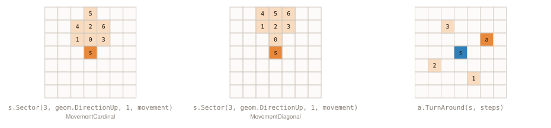
</picture>
</p>

```go
s, a := grid.Sq(3, 3), geom.Pt(5, 2) // a square and the index it is asked about

s.Neighbor(geom.DirectionUp)                            // (3,2)
s.Neighbors(grid.MovementDiagonal)                      // all 8, by increasing angle from the right
s.DistanceTo(a, grid.MovementCardinal)                  // 3, Manhattan; 2 with MovementDiagonal, Chebyshev
s.DirectionTo(a, grid.MovementCardinal)                 // Right, the nearest of the four; UpRight of the eight
s.Range(2, grid.MovementCardinal)                       // the 13 indices within two steps; also Ring, Spiral and LineTo
s.Sector(3, geom.DirectionUp, 1, grid.MovementCardinal) // the 7 indices of the cone a quarter-turn wide, ring by ring
```

A turn or a reflection returns a `Square`, so an index is converted to one first:

```go
grid.Square(a).TurnAround(s.Point(), 1) // (4,5), a quarter-turn around s, clockwise on a screen; negative steps go the other way
grid.Square(a).Turn(1)                  // (-2,5), around the origin
grid.Square(a).ReflectX()               // (5,-2), across the x-axis; also ReflectY
```

Each traversal has a `Seq` form, and the length functions size a buffer for it:

```go
buffer := make([]grid.Index, 0, grid.RangeLen(2, grid.MovementDiagonal)) // 25; RingLen and SectorLen size the others
buffer = slices.AppendSeq(buffer[:0], s.RangeSeq(2, grid.MovementDiagonal))
```

Sight takes a function saying what blocks, for a map or a grid to answer:

```go
s.HasLineOfSight(a, blocked)                      // blocked is a func(grid.Index) bool
s.FieldOfView(8, grid.MovementCardinal, blocked) // the indices within 8 steps in sight; also FieldOfViewSeq
```

### Hexagons

The coordinate math of hexagons is [`gravitton/hexagon`][link-hexagon]'s; this package places
them in the world. An index of a hexagonal grid is the offset coordinate of its system:
`OffsetOddQ` on a flat-top grid, `OffsetOddR` on a pointy-top one, and the even systems with
`EvenOffset`. The system converts it to a `hex.Hex` and back:

```go
import hex "github.com/gravitton/hexagon"

g := grid.NewHexFlatTop[Tile](size, grid.HexFlatTopCellScale(32))

h := hex.OffsetOddQ.From(geom.Pt(3, 2)) // Hex{3, 1}, the hex of a cell
g.Cell(hex.OffsetOddQ.To(h))            // and its cell back
```

Hexes with no grid around them need no conversion: a set of them is a `container.Set` like
`Region`:

```go
seen := container.SetOf(hex.Pt(0, 0).Range(3)...) // a set of hex.Hex
seen.Intersection(container.SetOf(hex.Pt(3, -1).Range(1)...))
```

A `HexLayout` places such hexes on an unbounded plane, for a map whose data lives elsewhere: in a
`map[hex.Hex]T`, a `container.Set`, a chunked world. Its indices are in the coordinate system it
is built with, and the center of index zero is its origin.

<p align="center">
<picture>
  <source media="(prefers-color-scheme: dark)" srcset="https://raw.githubusercontent.com/gravitton/grid/refs/heads/main/docs/images/hex-layout-dark.svg">
  <source media="(prefers-color-scheme: light)" srcset="https://raw.githubusercontent.com/gravitton/grid/refs/heads/main/docs/images/hex-layout-light.svg">
  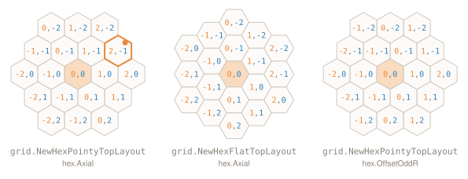
</picture>
</p>

```go
layout := grid.NewHexPointyTopLayout(grid.HexPointyTopCellScale(34), hex.Axial)

h := hex.Pt(2, -1)
layout.Center(h.Point())  // (51,-29.44), from the center of index zero at the origin
layout.Polygon(h.Point()) // the hexagon to draw or hit-test
layout.Bounds(h.Point())  // the geom.Box around it

hex.Axial.From(layout.IndexAt(geom.Pt(60.0, -40.0))) // Hex{2, -1}, the hex under a point

layout.CellSize()                              // 34x39.26, one hex as drawn; also CellSpacing and CellScale
layout.MoveTo(geom.Pt(400.0, 300.0))           // the center of index zero, to scroll the map
layout.Rescale(grid.HexPointyTopCellScale(48)) // the scale of a hex, to zoom it
```

Built with another system, the same hexes keep their places and take its indices: `hex.OffsetOddR`
numbers them as a pointy-top grid does. Moved to the center of a grid's index zero, a layout of the
grid's scale and system places every cell where the grid does, and puts a point on an edge
on the same side.

Full reference: [pkg.go.dev][link-go-dev-reference].

## Credits

- [Tomáš Novotný](https://github.com/tomas-novotny)
- [All Contributors][link-contributors]

## License

The MIT License (MIT). Please see [License File][link-licence] for more information.


[ico-license]:              https://img.shields.io/github/license/gravitton/grid.svg?style=flat-square&color=lightgrey
[ico-workflow]:             https://img.shields.io/github/actions/workflow/status/gravitton/grid/main.yml?branch=main&style=flat-square
[ico-release]:              https://img.shields.io/github/v/release/gravitton/grid?style=flat-square&color=e8883a
[ico-go-version]:           https://img.shields.io/github/go-mod/go-version/gravitton/grid?style=flat-square&color=007d9c
[ico-go-dev-reference]:     https://img.shields.io/badge/go.dev-reference-007d9c?style=flat-square
[ico-coverage]:             https://img.shields.io/coverallsCoverage/github/gravitton/grid?style=flat-square

[link-release]:             https://github.com/gravitton/grid/releases
[link-go]:                  https://go.dev/doc/devel/release
[link-contributors]:        https://github.com/gravitton/grid/contributors
[link-licence]:             ./LICENSE.md
[link-workflow]:            https://github.com/gravitton/grid/actions
[link-go-dev-reference]:    https://pkg.go.dev/github.com/gravitton/grid
[link-geometry]:            https://github.com/gravitton/geometry
[link-container]:           https://github.com/gravitton/container
[link-hexagon]:             https://github.com/gravitton/hexagon
[link-coverage]:            https://coveralls.io/github/gravitton/grid
